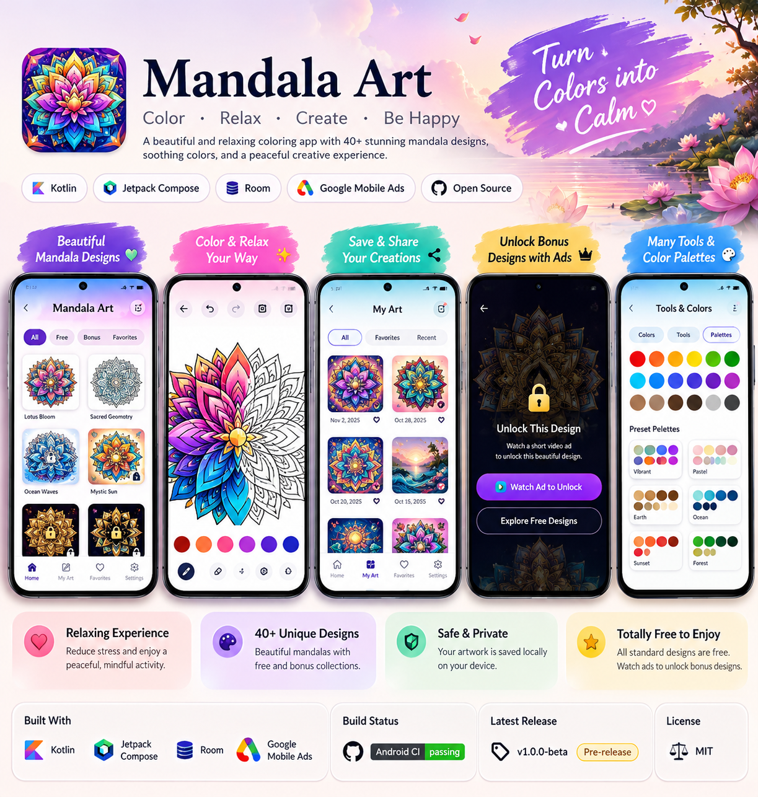

<!--
  Mandala Art — official product README.
  Keep product claims and download instructions aligned with the shipped app.
-->

<div align="center">



<br />

# MANDALA ART

### Find your colors. Follow the pattern. Make it yours.

**A mindful little coloring studio for Android.**

A collection of intricate mandala designs, expressive color choices, and room to slow down for a moment.

<br />

[](https://github.com/SamoTech/mandala-art-android/releases/latest)
[](https://github.com/SamoTech/mandala-art-android/releases)

[](https://github.com/SamoTech/mandala-art-android/actions/workflows/android-ci.yml)


<br />

<a href="https://github.com/SamoTech/mandala-art-android/releases/latest"><strong>↓ &nbsp; GET MANDALA ART</strong></a>
&nbsp;&nbsp; · &nbsp;&nbsp;
<a href="#the-experience">Discover the experience</a>
&nbsp;&nbsp; · &nbsp;&nbsp;
<a href="#for-developers">Developer guide</a>

</div>

---

<div align="center">

## A calmer kind of screen time

**Choose a pattern. Add a little color. Take a breath.**

No artistic experience needed. Start with a mandala, explore your palette, and turn a detailed line-art design into something personal.

</div>

## A look inside the app

<div align="center">
<table>
<tr>
<td align="center" width="33%">

<br /><sub><strong>Home screen</strong></sub>
</td>
<td align="center" width="33%">

<br /><sub><strong>Mandala gallery</strong></sub>
</td>
<td align="center" width="33%">

<br /><sub><strong>Mystic Daisy</strong></sub>
</td>
</tr>
<tr>
<td align="center" width="33%">

<br /><sub><strong>Color in progress</strong></sub>
</td>
<td align="center" width="33%">

<br /><sub><strong>Settings</strong></sub>
</td>
<td align="center" width="33%">

<br /><sub><strong>App identity</strong></sub>
</td>
</tr>
</table>
</div>

*Screenshots and artwork are from the repository's `docs/images` folder.*

## The Mandala Art experience

<table>
<tr>
<td width="50%" valign="top">

### ◉ A gallery of patterns

Explore **104 algorithmic mandala designs** — 24 hand-crafted originals plus 80 generated variations — from floral geometry to intricate symmetrical forms. 52 designs are available free; others can be unlocked through optional rewarded ads.

</td>
<td width="50%" valign="top">

### ◌ Your colors, your style

Bring each design to life with color choices that reflect your mood and imagination.

</td>
</tr>
<tr>
<td width="50%" valign="top">

### ↶ Create with confidence

Use **undo and redo** while working, so you can experiment and refine your artwork as you go.

</td>
<td width="50%" valign="top">

### ♡ Keep your artwork close

Return to your personal creations and continue enjoying the designs you have colored.

</td>
</tr>
</table>

## Explore the collection

A few of the designs included in Mandala Art:

| Design | Inspiration |
|:--|:--|
| **Lotus Bloom** | Petal-like symmetry |
| **Sunburst Harmony** | Radiating geometry |
| **Zen Wheel** | Balanced circular forms |
| **Four Seasons** | Nature-inspired detail |
| **Mystic Daisy** | Floral repetition |
| **Sacred Geometry** | Structured patterns |
| **Celestial Dahlia** | Layered floral shapes |
| **Arabesque Rosette** | Ornamental curves |

*The app includes additional designs. Availability and unlock behavior may vary by release.*

## Get started in a minute

<div align="center">

### Your next creative pause is one download away.

Download the **latest production APK** directly from this repository.

<br />

<a href="https://github.com/SamoTech/mandala-art-android/releases/latest"><strong>DOWNLOAD THE LATEST VERSION →</strong></a>

<br />

<sub>Open the release page, expand <strong>Assets</strong>, and choose the file named <code>Mandala-Art-*.apk</code>.</sub>

</div>

### Install the app

1. Open [Latest Releases](https://github.com/SamoTech/mandala-art-android/releases/latest).
2. Expand **Assets** and download the APK.
3. Open the downloaded file on your Android device.
4. If prompted, allow your browser or file manager to install apps from that source, then follow Android's instructions.

**Minimum requirement:** Android 7.0 (API 24) or later. Installing an APK outside Google Play can trigger an Android security warning; only install releases linked from this official repository.

### Check the APK checksum

Production releases include a `SHA256SUMS.txt` file when published. If you use a checksum utility, compare the APK's SHA-256 hash against that file. A matching checksum helps verify that the file has not changed; download the APK and checksum from the same official release.

---

## Product at a glance

| | |
|:--|:--|
| **App** | Mandala Art — Color. Relax. Create. |
| **Experience** | Mandala coloring and personal artwork |
| **Platform** | Android |
| **Minimum OS** | Android 7.0 (API 24) |
| **Built with** | Kotlin · Jetpack Compose |
| **Distribution** | Production APK via GitHub Releases |
| **Maintained by** | [SamoTech](https://github.com/SamoTech) |

## Privacy, permissions & advertising

Mandala Art integrates Google Mobile Ads, including optional rewarded advertising that may unlock additional designs. The app requests network access for online services and ads, and includes the Android advertising ID permission.

Read the project's [Privacy Policy](PRIVACY_POLICY.md) for more information. Advertising and data-handling behavior can change as SDKs and app versions change; consult the policy and the specific release you install rather than assuming the app operates entirely offline or collects no data.

## Project links

<div align="center">

[**Latest download**](https://github.com/SamoTech/mandala-art-android/releases/latest) &nbsp; · &nbsp;
[Release history](https://github.com/SamoTech/mandala-art-android/releases) &nbsp; · &nbsp;
[Privacy policy](PRIVACY_POLICY.md) &nbsp; · &nbsp;
[Report a problem](https://github.com/SamoTech/mandala-art-android/issues) &nbsp; · &nbsp;
[Build workflow](https://github.com/SamoTech/mandala-art-android/actions/workflows/android-ci.yml) &nbsp; · &nbsp;\n[**Product & Engineering Roadmap**](docs/ROADMAP.md)

</div>

---

<details>
<summary><strong>For developers — build, test, and contribute</strong></summary>

<a id="for-developers"></a>

### Requirements

- Android Studio
- Android SDK compatible with the project
- A JDK compatible with the Gradle configuration

### Get the source

```bash
git clone https://github.com/SamoTech/mandala-art-android.git
cd mandala-art-android
```

The repository pins Gradle 9.3.1 via `gradle/wrapper/gradle-wrapper.properties`, but the Gradle wrapper scripts are not committed; CI generates them automatically. For a local build, generate them once using an installed Gradle 9.3.1:

```bash
gradle wrapper --gradle-version 9.3.1 --distribution-type bin
```

Open the project in Android Studio and allow Gradle sync to finish.

### Build a debug APK

**Windows PowerShell**

```powershell
.\gradlew.bat assembleDebug
```

**macOS / Linux**

```bash
./gradlew assembleDebug
```

### Run unit tests

```bash
./gradlew :app:testDebugUnitTest
```

On Windows, run ` .\gradlew.bat :app:testDebugUnitTest ` instead.

The debug APK is normally generated at `app/build/outputs/apk/debug/app-debug.apk`. Debug builds are intended for development and testing, use the debug signing configuration, and are not the recommended download for end users. Production builds are handled by the repository's GitHub Actions workflow.

### License

See [LICENSE.md](LICENSE.md) for the project's code and artwork license and notices for third-party dependencies.

</details>

<div align="center">

---

### Make a little space for color.

**Mandala Art** · Color. Relax. Create.

Crafted by [SamoTech](https://github.com/SamoTech).

</div>
